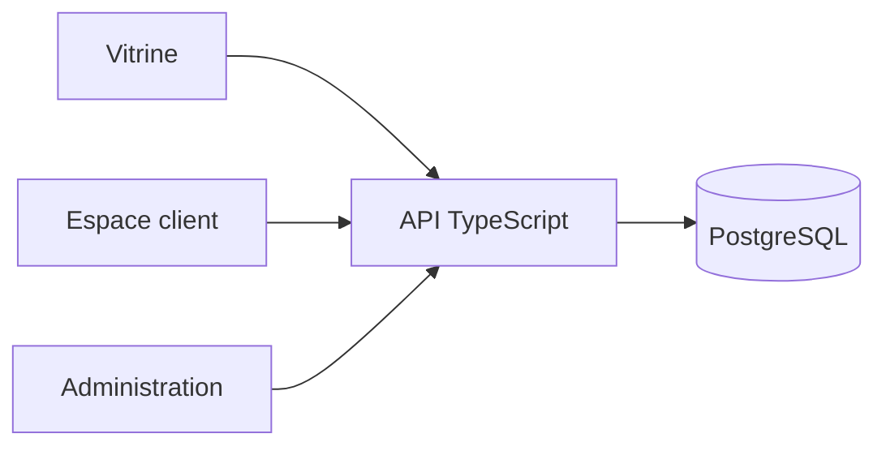

# Sirius Studio

Site et **espace de travail** de Sirius Studio : vitrine, demandes de maquette, espace client et administration des projets.

<p align="center">
  
  
  
  
  
</p>

<p align="center">
  <strong>Dépôt :</strong> <a href="https://github.com/Meriem1403/Sirius-Studio">github.com/Meriem1403/Sirius-Studio</a>
</p>

---

## Sommaire

- [Présentation](#présentation)
- [Fonctionnalités](#fonctionnalités)
- [Stack technique](#stack-technique)
- [Architecture](#architecture)
- [Prérequis](#prérequis)
- [Installation](#installation)
- [Variables d'environnement](#variables-denvironnement)
- [Déploiement](#déploiement)
- [Sécurité](#sécurité)
- [Structure du projet](#structure-du-projet)
- [Documentation](#documentation)
- [Scripts disponibles](#scripts-disponibles)

---

## Présentation

Le site public présente le studio et recueille une demande de maquette. Une fois le compte créé, le client suit ses projets, ses documents, ses messages et sa facturation. L'équipe studio a le miroir côté administration : portefeuille, prospection, agenda, notifications.

L'API est un serveur TypeScript devant PostgreSQL. La connexion peut passer par un mot de passe ou par Google, GitHub et Microsoft.

---

## Fonctionnalités

| Espace | Écrans |
|--------|--------|
| **Public** | Accueil, demande de maquette, inscription, connexion |
| **Client** | Tableau de bord, projets, nouvelle demande, documents, messages, facturation, agenda, profil, notifications |
| **Administration** | Tableau de bord, projets, prospection, portfolio, messages, facturation, agenda, notifications |
| **API** | Auth, OAuth, clients, prospects, demandes, messages, contact, espace de travail |

---

## Stack technique

| Couche | Technologies |
|--------|----------------|
| Frontend | React 19, TypeScript, Vite, Tailwind CSS, React Router |
| API | Node.js, TypeScript (`server/`) |
| Données | PostgreSQL |
| Auth | JWT, OAuth Google, GitHub, Microsoft |
| Courriel | Resend |
| Conteneurisation | Docker Compose |
| Frontend statique | Netlify (`dist`) |

---

## Architecture



---

## Prérequis

- **Node.js** 20 et npm
- **Docker**, pour la base et la pile complète
- **Git**

---

## Installation

```bash
git clone https://github.com/Meriem1403/Sirius-Studio.git
cd Sirius-Studio
cp .env.example .env
npm install
npm run dev
```

L'API se lance à part avec `npm run dev:api`, ou l'ensemble avec `npm run dev:docker`.

Le parcours client automatisé : `npm run test:client-journey`.

---

## Variables d'environnement

Développement (`.env.example`) :

| Variable | Rôle |
|----------|------|
| `VITE_API_BASE_URL` | URL de l'API vue par le navigateur |
| `DATABASE_URL` | PostgreSQL |
| `PORT` | Port de l'API |
| `JWT_SECRET` | Signature des sessions |
| `CORS_ORIGIN`, `PUBLIC_APP_URL` | Origines |
| `ADMIN_NOTIFY_EMAIL`, `RESEND_API_KEY`, `MAIL_FROM` | Notifications |
| `SEED_ON_START` | Jeu de données au démarrage, développement seulement |

Production (`.env.production.example`) ajoute le domaine d'API, les identifiants OAuth (Google, GitHub, Microsoft) et l'utilisateur PostgreSQL. Les fichiers d'exemple ne contiennent pas de clés réelles.

---

## Déploiement

| Cible | Fichier |
|-------|---------|
| Local | `docker-compose.yml`, [LOCAL.md](./LOCAL.md) |
| Production | `docker-compose.prod.yml`, dossier `deploy/`, [PRODUCTION.md](./PRODUCTION.md) |
| Netlify | `netlify.toml` : `npm run build`, dossier `dist` |
| Guide | [DEPLOIEMENT.md](./DEPLOIEMENT.md) |

Nginx de production : `nginx.conf`.

---

## Sécurité

- JWT et clés OAuth hors de Git.
- `SEED_ON_START` ne s'active pas en production.
- CORS limité à `CORS_ORIGIN`.
- Les secrets Resend et OAuth se posent sur l'hôte, pas dans un exemple commité.

---

## Structure du projet

```
Sirius-Studio/
├── src/pages/            # Public, client/, admin/
├── server/src/routes/    # Auth, OAuth, projets, messages
├── deploy/
├── docker-compose.yml
├── docker-compose.prod.yml
└── netlify.toml
```

---

## Documentation

| Document | Contenu |
|----------|---------|
| [LOCAL.md](./LOCAL.md) | Poste de développement |
| [PRODUCTION.md](./PRODUCTION.md) | Environnement de production |
| [DEPLOIEMENT.md](./DEPLOIEMENT.md) | Mise en ligne |

---

## Scripts disponibles

| Commande | Description |
|----------|-------------|
| `npm run dev` | Frontend Vite |
| `npm run dev:api` | API |
| `npm run dev:docker` | Pile Docker |
| `npm run build` | Build frontend |
| `npm run preview` | Prévisualisation |
| `npm run lint` | ESLint |
| `npm run test:client-journey` | Parcours client |

---

<p align="center">
  <sub>Sirius Studio — vitrine, espace client et administration.</sub>
</p>
